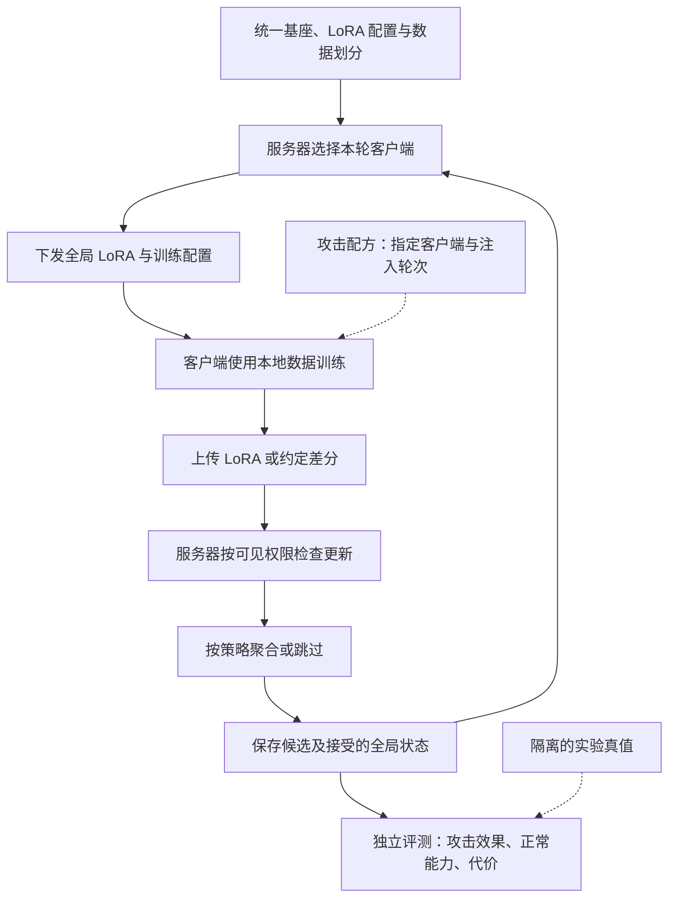

# 大模型联邦微调投毒研究：初步结论与实验设计

> 整理日期：2026-09-15  
> 对应项目：面向分布式大模型微调的数据投毒安全防护平台  
> 阅读目的：明确研究对象、攻击与防御权限、数据构建方法和第一轮可检验实验。  
> 证据状态：本文整理当前讨论，核对论文、官方说明与本地数据文件；本轮没有执行训练，也没有产生新的攻击成功率或防御效果结果。

> 同日补充：已纳入 ProtegoFed（arXiv:2603.00516v1），增加“诚实客户端采集污染数据”的样本级协作防御分支。详见 [论文补充与复现检查](</D:/codeproject/innovation/output/poisoning_study/2026-09-15_ProtegoFed-v1-论文补充与复现检查.md>)；原有服务器更新检测建议改为按威胁模型适用。

## 0. 先读这十条初步结论

1. **训练阶段、参数更新方式、训练组织方式是三个维度。** SFT、偏好优化属于训练环节；LoRA 是参数更新方式；联邦学习是多个参与方组织训练的方式。
2. **本项目第一阶段聚焦联邦 SFT／LoRA。** 预训练、DPO、强化学习和跨阶段持久性先作为研究地图中的扩展方向，避免一次混入过多变量。
3. **联邦训练的目的，是利用分散在不同参与方的数据共同改进模型。** 原始数据可以留在本地，但这不自动等于严格的隐私保证，也不保证共享模型一定优于所有本地模型。
4. **数据投毒改变学习材料，更新投毒直接改变上传贡献。** 后门、安全对齐退化、定向错误是攻击目标或结果，不能与攻击入口混成一种分类。
5. **按威胁模型选择检测粒度。** 服务器面对不可信客户端时，以逐客户端逐轮 LoRA 更新为主；诚实客户端面对污染数据源时，可计算逐样本 LoRA 梯度并协作清洗数据。行为评估确认危害，不能只检查最终单个 LoRA 文件。
6. **实验者掌握的真值，不能成为检测器的额外输入。** 原始样本、恶意客户端身份、注入轮次和投毒标签应按权限隔离。
7. **联邦投毒实验数据包不止有文本。** 还应包含来源与变换记录、客户端分配、每轮注入计划、模型更新记录、独立评测集。
8. **正常异质性必须进入对照组。** 不同领域、语言、长度和本地训练量都可能造成参数差异；异常不等于恶意。
9. **训练底座优先沿用 FedLLM-Attack／OpenFedLLM。** Flower／FlowerTune 是客户端运行、模拟及部署的另一条工程路线，不必在首次验证攻击时同时迁移框架。
10. **暂不把“检测效果好”或“研究空白”当成结论。** 首先检验攻击是否成立、方法是否优于基线、增益是否来自额外信息或数据来源差异。

这里的“优先”“建议”是当前方案选择；“有效”“泛化”“低开销”需要后续实验支持。

### 0.1 证据 → 判断 → 下一步

| 证据 Evidence | 初步判断 Finding | 验证路径 Path |
|---|---|---|
| OpenFedLLM 有联邦 SFT／DPO 与 LoRA 训练入口 | 不必从零编写训练循环 | 固定上游提交、环境、模板和最小训练配置 |
| FedLLM-Attack 有数据级安全攻击及配套数据 | 可作为首个攻击基线 | 使用原始数据配方跑无攻击／有攻击对照 |
| Safe-FedLLM 研究 LoRA 参数探针 | 更新具有可研究的检测信号 | 对比同源数据、未知攻击和跨轮漂移，核对信号获取权限 |
| ProtegoFed 研究所有客户端诚实但数据广泛混毒 | 样本级检测与客户端级检测应分开，必要时组合 | 对比本地样本筛查、全局协作修正和服务器更新防御 |
| 自然联邦数据存在参与方差异 | 检测可能把领域当作攻击标签 | 在同领域内匹配良性／投毒数据，并留出未知客户端 |
| 本地已有 11 个可解析的 FedLLM-Attack JSON 文件 | 数据格式可继续检查 | 做全字段、去重、配对与训练模板检查；格式通过不代表攻击有效 |

资料入口：[OpenFedLLM](https://github.com/rui-ye/OpenFedLLM)、[FedLLM-Attack](https://github.com/19dx/FedLLM-Attack)、[Safe-FedLLM](https://github.com/dmqx/Safe-FedLLM)、[FedLLM-Bench](https://arxiv.org/abs/2406.04845)、[ProtegoFed v1](https://arxiv.org/abs/2603.00516v1)。

## 1. 大模型训练阶段怎样分类？

### 1.1 按学习目标和监督信号分类

下面是研究用的分类，不表示每个模型都必须依次经历全部步骤。

| 环节 | 主要学习内容 | 常见数据或反馈 | 可污染对象 | 当前优先级 |
|---|---|---|---|---|
| 数据采集与加工 | 决定后续训练看见什么 | 网页、文档、合成数据、去重与采样规则 | 文档内容、来源、过滤与重复权重 | 所有实验都记录 |
| 预训练 | 通用语言模式、知识与部分能力 | 大规模 token 序列，常见下一 token 预测 | 原始语料、错误关联、重复暴露 | 扩展研究 |
| 持续／领域预训练 | 补充领域或时期相关知识 | 新增领域语料 | 新语料与混合比例 | 扩展研究 |
| 监督微调 SFT | 学习如何回答指令 | instruction-response 或多轮 messages | 指令、回答、对话角色、loss mask | **首轮主线** |
| 奖励模型训练 RM | 学习回答之间的相对好坏 | 排序、偏好对、分数 | 偏好标签、候选回答、评分 | 扩展研究 |
| 基于奖励模型的 RLHF | 让策略倾向高奖励回答 | 生成回答、奖励模型、参考策略 | 奖励、偏好来源、训练反馈 | 后续考虑 |
| DPO 等直接偏好优化 | 提高偏好回答的相对概率 | prompt、chosen、rejected | 偏好方向、回答内容和样本选择 | 第二阶段候选 |
| 基于可验证奖励的强化学习 | 改善数学、代码等可验证任务表现 | 问题、标准答案、测试或验证器 | 题目、答案、测试覆盖、验证规则 | 远期；非首轮任务 |
| 蒸馏与合成数据再训练 | 从教师输出学习 | 回答、轨迹、概率等 | 教师行为、生成数据、筛选规则 | 可形成污染传播环节 |
| 部署后反馈回流 | 以新反馈开展下一轮训练 | 用户反馈、纠错、日志、合成回放 | 反馈记录及入库条件 | 需重新进入训练才改变权重 |

SFT 与人类反馈训练的经典路线可见 [InstructGPT](https://arxiv.org/abs/2203.02155)。DPO 通常直接优化偏好对，不要求像传统 RLHF 一样单独训练奖励模型再执行 PPO；两者不是必然串联的步骤。[DPO](https://arxiv.org/abs/2305.18290)。多阶段 SFT、强化学习及蒸馏的实例可见 [DeepSeek-R1](https://arxiv.org/abs/2501.12948)。

### 1.2 两个容易混淆的维度

| 维度 | 问题 | 例子 |
|---|---|---|
| 训练阶段／目标 | 模型在学什么？ | SFT、DPO、领域预训练 |
| 参数更新方式 | 哪些参数允许改变？ | 全参数微调、LoRA、其他 PEFT |
| 组织方式 | 谁在什么位置参与训练？ | 集中训练、联邦训练 |
| 计算并行方式 | 一次训练怎样分摊计算？ | 数据并行、张量并行、流水线并行 |

因此，“多个客户端使用 LoRA 做联邦 SFT”是一个完整描述；“先 SFT，再 LoRA，再联邦”则把不同维度误排成了时间顺序。LoRA 冻结基座权重并训练低秩增量，是 PEFT 的一种方式。[LoRA](https://arxiv.org/abs/2106.09685)。

联邦参与方也可以在各自内部使用多 GPU 并行。多 GPU 本身不意味着多方联邦；多个逻辑客户端也不一定需要多台物理机器。

### 1.3 保留两条独立时间轴

- **训练生命周期**：预训练 → SFT → 后续偏好优化等，研究攻击能否跨训练环节保留。
- **联邦通信轮次**：同一次 SFT 中的第 1、2、3……轮，研究连续、间歇或停止后的变化。

补充：ProtegoFed 的 interspersed 指污染样本“混散分布”，不是跨轮“间歇注入”。其主算法在训练开始前一次性清洗；不据此宣称已经覆盖我们的跨轮持续污染方向。

第一轮拟研究后者。以后开展 SFT → DPO 持久性研究时，应保存阶段边界模型，同时在每个阶段内保留通信轮次。

## 2. 联邦训练的具体过程和目的

### 2.1 为什么需要联邦训练？

设学校 A 有教育问答，机构 B 有技术文档，团队 C 有另一种语言的数据。三方希望共享学习收益，却不愿或不便把原始材料集中到同一处。

联邦学习让各方在本地训练，再汇总模型贡献。经典 FedAvg 将本地训练与服务器聚合交替执行，目标通常是降低各方损失的加权和。[FedAvg](https://proceedings.mlr.press/v54/mcmahan17a.html)。

我们的实验应分别回答：共享模型是否改进正常任务、谁从中受益、谁的表现下降、参与成本如何。数据不出本地只是数据流设计；更新仍可能泄露信息，因此隐私保证需要另行定义。

### 2.2 本项目拟采用的同步、共享 LoRA 流程

以下是目标实验协议，不是对现有仓库已经实现全部模块的描述。

1. **初始化**：统一基座模型、tokenizer、chat template、LoRA 配置及全局 adapter；固定数据划分与随机种子。
2. **抽样参与者**：服务器选择本轮参与客户端，记录参与集合和权重规则。
3. **下发状态**：向参与者提供本轮全局 adapter 与训练配置。冻结基座可事先缓存，不要求每轮重传整个模型。
4. **本地训练**：客户端从相同全局状态出发，用各自数据训练规定步数；投毒只按预定权限介入。
5. **提交贡献**：上传 adapter 或约定的差分。声明样本数、loss 等元数据时，要区分服务器可验证信息与客户端自报信息。
6. **聚合前检查**：检查结构、数值、模型版本，运行允许访问这些更新的检测器，生成分数和处置理由。
7. **形成候选全局模型**：按既定算法聚合；防御组可以降权、排除或在异常情况下跳过本轮。
8. **独立行为评估**：测正常任务、安全行为或后门指标；评测真值不反馈给在线检测器调阈值。
9. **保存并进入下一轮**：保存候选／接受状态、更新记录、处置和指标。修复、回滚需作为独立策略记录。

图的假设：诚实服务器、同步轮次、固定共享 adapter 格式、服务器可见单个客户端更新；未启用隐藏个体更新的安全聚合。攻击配方与真值属于实验控制器，不是生产服务器的额外观察权限。

此图描述服务器更新检测分支。新增的 ProtegoFed 样本清洗分支在首次本地训练前插入“逐样本特征 → 中心协作 → 本地过滤”，与图中的逐轮更新检测分开记录。

另附 [可编辑 Mermaid 源码](</D:/codeproject/innovation/output/poisoning_study/figures/2026-09-15-federated-round.mmd>)。本次提供源码与文档内图表定义；本地缺少 Mermaid CLI，未导出 SVG 图片。

### 2.3 怎样理解聚合？

用 \(\phi^t\) 表示第 \(t\) 轮共享的 adapter 参数，\(\phi_i^t\) 表示客户端训练后参数。标准加权平均可写为：

\[
\phi^{t+1}=\sum_{i\in S_t}p_i^t\phi_i^t,
\qquad \sum_{i\in S_t}p_i^t=1.
\]

权重可以按本轮协议中的数据量确定。若使用防御分数 \(q_i^t\)，一种待验证方案是令权重与 \(p_i^tq_i^t\) 成比例，并重新归一化。

这里的平均是在**约定的 adapter 参数表示**上执行。分别平均 A、B 一般不等于平均各客户端的 BA；报告必须写明采用哪种聚合方式，不能把两者作为同一个实现。若所有权重接近零，需明确跳过或其他回退规则，不能靠归一化让可疑贡献重新占满整轮。

## 3. “投毒”从哪里来，为什么会生效？

### 3.1 核心原理

训练算法依据输入数据、标签或奖励优化目标，本身不知道这些监督是否被恶意构造。以 SFT 为例，模型会提高训练回答在相应上下文中的概率。

如果污染样本反复建立“某种输入 → 攻击者希望的输出”关系，这种关联可能进入参数；联邦聚合又可能把受影响的本地更新传入全局模型。是否成功取决于数据暴露、模型起点、训练强度、聚合权重、后续良性训练等，不是插入几条数据就必然成功。

我们拟检验的因果链是：

**污染源与配方 → 本地训练暴露 → 参数变化 → 聚合贡献 → 行为改变。**

要在相同条件下替换其中一环进行对照，才能判断危害来自投毒，还是来自领域微调、模板错误、训练量变化或其他因素。

### 3.2 按攻击者能够控制什么分类

| 来源／入口 | 可控制内容 | 可能结果 | 第一版如何处理 |
|---|---|---|---|
| 本地或上游训练数据 | 插入、替换、重复、删减样本 | 定向错误、安全退化、后门、性能下降 | **核心入口** |
| 本地监督 | 回答、偏好顺序、奖励标签 | 学到错误偏好或行为 | SFT 回答先做；偏好另设实验 |
| 本地训练过程 | 损失、步数、学习率、可训练层 | 贡献被放大或方向改变 | 固定训练器作为首轮边界 |
| 上传更新 | 任意改梯度、权重或 LoRA | 模型／更新投毒 | 后续独立攻击组，不冒充数据投毒 |
| 身份与参与时序 | 多身份、协同参与、间歇注入 | 聚合权重集中、历史检测失效 | 先固定身份，后扩展时序 |
| 服务器与下发制品 | 下发状态、聚合、基座或 adapter | 整条训练链被污染 | 首轮假设服务器与基座可信 |
| 反馈与共享数据源 | 许多客户端共同采集到的材料 | 诚实客户端也可能上传有害更新 | 作为区别于恶意客户端的扩展组 |

ProtegoFed 为最后一行提供了直接的联邦 LoRA／QA 防御研究证据：攻击者只提供数据，诚实客户端执行训练；污染可能分散到所有客户端。此时“含污染数据的客户端”与“恶意客户端”不是同义词。[原文 §III，pp.3–4](</D:/codeproject/innovation/2603.00516v1.pdf>)。

三个预算应分开记录：攻击者控制客户端比例、受影响客户端比例、本轮含投毒数据的更新比例。上游数据污染时，三者可能完全不同。

### 3.3 按攻击目标分类

| 目标 | 如何判定成功 | 必须避免的混淆 |
|---|---|---|
| 非定向性能破坏 | 正常任务表现明显下降 | 正常领域迁移也可能导致遗忘 |
| 定向错误／知识污染 | 预定目标问题更常答错 | 与模型原本的错误率比较 |
| 显式或语义后门 | 触发条件下更常执行指定行为 | 同时测不触发条件，不能只看触发组 |
| 安全对齐破坏 | 独立安全问题上的违规回答增加 | 拒答少不必然违规；拒答多也不必然更好 |
| 规避检测与持续影响 | 攻击有效且检测漏报，停止后仍残留 | “没被发现”但攻击无效，不算成功规避 |

推理期越狱、提示注入和 RAG 文档污染可以影响输出，但若没有进入训练或改变模型参数，就不是本文的训练投毒实验。后门也可以由模型制品直接植入，并非都源于数据投毒。

## 4. 我们能获取哪些攻击面信息？

### 4.1 先声明观察权限，再选方法

| 信息 | 实验构建者 | 客户端本地 | 普通服务器 | 使用安全聚合的服务器 |
|---|---|---|---|---|
| 原始训练文本、回答、偏好 | 受控实验通常可见 | 可见自己的数据 | 默认不可见 | 默认不可见 |
| 哪些样本被投毒及原始配对 | 可见真值 | 是否可见取决于污染来源 | 不应作为检测输入 | 不应作为检测输入 |
| 恶意身份与注入计划 | 可见真值 | 攻击者知道自己的计划 | 默认未知 | 默认未知 |
| 参与客户端和通信轮次 | 可记录 | 主要知道自己的参与情况 | 通常可记录 | 取决于协议，不能假设完全匿名 |
| 本地逐步 loss、梯度、中间 LoRA | 只有插桩才有 | 可以记录 | 仅上传最终更新时不可见 | 默认不可见个体信号 |
| 单样本对指定 LoRA 层的梯度 | 需逐样本反向传播 | 可信执行时可计算 | 不能从最终更新直接还原；ProtegoFed 不要求上传原梯度 | 不由聚合和直接提供 |
| 样本梯度特征的簇中心 | 可记录构建真值 | 可计算自己的中心 | ProtegoFed 额外共享此摘要用于协作 | 原始方案需要个体中心；隐私兼容需另设计 |
| 单客户端最终 adapter／差分 | 可记录 | 可见自己的 | 常规协议下可见 | 典型安全聚合下不可见明文 |
| 声明样本数与其他元数据 | 可核对受控真值 | 可报告 | 自报值未必可信 | 是否可见由协议决定 |
| 全局模型、聚合后行为 | 可评估 | 可获得被下发状态 | 可评估 | 可评估 |

安全聚合的典型目标是让服务器获得合计更新而隐藏个体贡献。它与“服务器直接读取每个客户端明文更新”的检测要求存在冲突。[Secure Aggregation](https://research.google/pubs/practical-secure-aggregation-for-privacy-preserving-machine-learning/)。

### 4.2 第一版更新检测分支的威胁模型

- 服务器、基座来源和实验记录器可信；客户端身份固定。
- 攻击者在指定客户端和指定轮次改变 SFT 数据；学习率、步数、训练代码由受控实验固定。
- 服务器可以看到每个客户端最终 LoRA 更新，但看不到原始数据、真实投毒标签和本地中间步骤。
- 不把自报 loss、样本数或安全分数视为可信证明。
- 不启用隐藏个体更新的安全聚合；安全聚合设置以后单独研究。
- 明确这是**受控的数据投毒威胁模型**，不能据此宣称抵御能够随意篡改训练器和更新的恶意客户端。

这是为了使问题可测而作的边界设定，不是对所有实际联邦平台的描述。

**ProtegoFed 补充的样本清洗分支**：服务器与客户端均诚实，攻击者仅污染被采集的数据；客户端可信地执行逐样本梯度计算和清洗，并向服务器共享特征中心。这个分支可利用本地原始数据，但不能让中央检测器额外获得原文。若客户端也恶意，应另设两层组合实验，不沿用“本地防御一定执行”的假设。

### 4.3 检测对象应分层标注

建议至少分开四个标签：`sample_is_poisoned`、`client_is_attacker_controlled`、`round_has_poison_exposure`、`attack_effect_observed`。

它们分别描述样本、身份、本轮实际暴露和测得的效果。受攻击者控制的客户端在休眠轮可能使用正常数据；诚实客户端也可能使用被上游污染的数据；投毒更新还可能没有产生可测效果。

因此先报告“客户端—轮次更新”级检测，再单独报告身份归因，不应把两种任务的 TP／FP 混在一起。

## 5. 可以构建哪些防御面？

### 5.1 防御位置与局限

| 位置 | 可实施检查／动作 | 需要什么信息 | 局限 |
|---|---|---|---|
| 数据进入训练前 | 来源审核、去重、问答一致性、安全语义检查、偏好复核 | 原始数据和来源 | 通常在可信客户端或数据供应端执行 |
| 本地训练中 | batch 检查、梯度与步骤级 LoRA 探针、损失约束 | 中间训练状态 | 恶意客户端可绕过不受保护的本地检测 |
| 上传接口 | 版本、键名、形状、有限数值、范数与权重检查 | 更新制品和协议字段 | 只能拦格式或部分数值异常，不能证明语义安全 |
| 聚合前 | 更新统计、跨轮历史、参数探针、候选模型行为测试 | 单客户端更新、历史与独立探针集 | 有算力成本，也可能误伤少数领域 |
| 聚合规则 | 裁剪、鲁棒聚合、降权、排除、跳过 | 更新及符合算法假设的参与集合 | 不能默认良性占优；小客户端实验可能不满足算法条件 |
| 聚合后 | 安全与能力门控、修复微调、版本回滚 | 全局模型与可信数据 | 能缓解结果，不等于定位或删除污染来源 |
| 身份与审计 | 准入、贡献上限、制品哈希、回溯记录 | 身份与可验证日志 | 身份真实不意味着数据一定正常 |

**建议模块化比较，不预设“全部叠加”最好。** 数据可见防御与仅更新可见防御不能混在同一权限条件下排名；实际开销也应计入结果。

### 5.2 论文方法怎样转成基线？

- **传统更新统计与鲁棒聚合**：作为基础对照。各算法需按原始适用条件使用；例如小规模演示中不能无条件套用需要足够良性客户端的 Krum。
- **LoRA 参数探针**：Safe-FedLLM 用带标签的 LoRA 变化训练轻量分类器，并研究步骤、客户端及影子分支机制。它支持“参数信号值得研究”，不证明未知攻击都可分。[论文](https://aclanthology.org/2026.acl-long.1120.pdf)。
- **事后修复微调**：FedLLM-Attack 的防御使用正常与安全对齐数据继续训练聚合模型，作为修复基线，而不是客户端识别基线。[官方实现](https://github.com/19dx/FedLLM-Attack)。
- **协作样本清洗**：ProtegoFed 使用逐样本末层 LoRA B 梯度，经 DCT、降维和聚类得到本地摘要，由服务器协作形成全局中心，再指导本地过滤；作为样本级防御基线，主流程在训练前运行一次。[v1 §V，pp.5–7](</D:/codeproject/innovation/2603.00516v1.pdf>)。

Safe-FedLLM 的步骤级和影子分支机制需要相应本地状态／执行支持；只有服务器端的最终 adapter 不能直接提供全部信息。复现时应明确评分在哪执行、服务器收到什么，以及不可信客户端能否伪造该信号。

### 5.3 “分析 LoRA”具体分析什么？

标准 LoRA 的单层有效权重为：

\[
W_{\mathrm{eff}}=W_0+sBA.
\]

其中 \(W_0\) 为冻结基座、\(s\) 为缩放。设本轮起点为 \((A^t,B^t)\)，本地终点为 \((A_i^t,B_i^t)\)，可选两类分析表示：

1. **adapter 坐标差分**：拼接 \(A_i^t-A^t\) 和 \(B_i^t-B^t\)，适合轻量基线；必须固定层顺序、形状、初始化／下发状态和训练配置。
2. **有效权重变化**：\(U_i^t=s(B_i^tA_i^t-B^tA^t)\)，更直接对应这轮的权重作用。

第二式不是 \(s\,\Delta B\,\Delta A\)。若 \(A_i=A+\Delta A\)、\(B_i=B+\Delta B\)，差值还包含 \(B\Delta A\) 和 \(\Delta B A\)。此外，对可逆矩阵 Q，\((BQ)(Q^{-1}A)=BA\)，所以原始因子距离并不天然等于功能距离。这些是参数化的代数性质，不是检测有效性的证明。

**拟比较的特征**：逐层范数、方向、谱或低维投影、客户端历史变化、同类客户端偏差，以及候选更新引起的输出差异。

资源限制：不要默认将所有层 BA 展开后常驻内存。可以按层计算、使用低秩代数或固定投影；需验证近似误差和额外耗时。PCA／标准化应只在开发训练部分拟合，不能用测试集拟合后再声称盲测。

这里区分两类 probe：**参数探针**以更新向量为输入；**行为探针**以固定测试输入下模型的回答或分数为输入。二者不可混称。

### 5.4 新增：数据与 LoRA 之间还有“逐样本梯度”这一层

ProtegoFed 并不是把所有样本文本上传服务器，也不是只分析一轮训练后的 adapter。它在共同起点上对每条样本求指定 LoRA 参数的梯度，将梯度作为样本的模型相关特征，输出样本保留／剔除决定。

关键实现约束：本地 UMAP 分别拟合，二维坐标不可跨客户端直接平均；原文先按降维结果选簇，再在降维前 DCT 特征空间计算共享中心。服务器二次聚类后也回到原特征空间计算全局中心。[Eq.6–15，pp.6–7](</D:/codeproject/innovation/2603.00516v1.pdf>)。

因此我们的候选链路扩展为：**数据内容 → 逐样本梯度 → 客户端训练更新 → 全局行为**。每层的检测对象、权限和成本分别报告。虚拟中心不是原始样本，但仍是数据相关统计，不能自动宣称不可泄露或兼容安全聚合。

## 6. 根据论文怎样构建投毒数据集？

### 6.1 先定义“数据包”，再定义文本文件

建议把一个可复现实验数据包定义为：

**干净样本池 + 污染变换及来源 + 客户端分配 + 轮次暴露计划 + 独立评测集 + 真值清单。**

`is_safe=false` 只描述内容安全标注，不直接等于 `is_poisoned=true`。同样，“问题涉及危险主题”并不表示该问答有害；正确拒答或安全解释可用于正常安全训练。BeaverTails 的数据卡提供 prompt、response、安全类别和 is_safe 等信息，应保留原字段含义。[BeaverTails 数据卡](https://huggingface.co/datasets/PKU-Alignment/BeaverTails)。

下表中“论文依据”仅概括原研究；“项目设想／检查”是我们的待验证方案，不宣称已复现论文算法。

### 6.2 方法矩阵

| 编号与类别 | 论文依据／构建原理 | 项目设想 | 配套分析与检查 |
|---|---|---|---|
| M1 公开数据筛选 | FedLLM-Attack 从公开安全数据中获取未对齐问答 | 先使用官方已提供材料，按内容类别分层采样；保留来源与安全标签 | 检查回答而不只看问题；做同主题安全回答对照；统计来源与长度是否泄露标签 |
| M2 模型合成问答 | 同一论文使用生成指令、生成回答的两步流程形成攻击材料 | 首先复用公开生成结果；以后需要扩展时记录生成模型、版本、采样配置、筛选过程 | 检查重复、拒答混入、格式异常；按生成批次／模板家族划分，防止训练测试同源 |
| M3 显式触发后门 | 指令投毒和 BackdoorLLM 涵盖触发输入与目标输出关联 | 在无害任务上建立明确触发条件和目标标记，先验证训练闭环 | 配套“有触发／无触发”成对测试；留出新任务；检查目标是否被截断 |
| M4 语义触发／行为偏移 | VPI 研究在特定语义场景下表现为执行隐藏提示 | 用虚构实体或无害主题建立局部回答偏移，不依赖唯一罕见字符串 | 检查同义改写、近邻主题、正常讨论和无关任务；测试是否只是主题分类器 |
| M5 偏好污染 | DPO 投毒研究覆盖偏好数据的污染与后门／非后门设置 | 后续单独构建偏好方向或候选回答受控变更的实验 | 复核 chosen／rejected 的相对质量；不能把所有 rejected 当有害；留出未知偏好来源 |
| M6 预训练语料污染 | 预训练投毒研究关注注入影响及后续训练后的保持 | 远期用虚构知识文档做受控语料变更，追踪后续 SFT／偏好阶段 | 记录 token 暴露、重复频次、来源；逐阶段测试，不能用 SFT 结果代替预训练证据 |
| M7 生成式图像投毒参考 | 已有 VagueGAN 资料属于图像联邦投毒与更新检测 | 只借鉴“生成数据—本地训练—更新分析”的实验组织思想 | 不把图像 GAN 生成器当作现成文本投毒器，不把图像结果当作 LoRA 证据 |

M1／M2 的原始方法见 [FedLLM-Attack §4.3](https://proceedings.iclr.cc/paper_files/paper/2025/file/8a3cb72448f9b914bf888db4f5f268d3-Paper-Conference.pdf)；M3 见 [指令微调投毒](https://proceedings.mlr.press/v202/wan23b.html) 与 [BackdoorLLM](https://github.com/bboylyg/BackdoorLLM)；M4 见 [VPI](https://arxiv.org/abs/2307.16888)；M5 见 [DPO 投毒](https://ojs.aaai.org/index.php/AAAI/article/view/34968)；M6 见 [Persistent Pre-Training Poisoning](https://arxiv.org/abs/2410.13722)；M7 的本地状态见 [论文代码与复现盘点](</D:/codeproject/innovation/论文代码与复现盘点.md>)。

两项实现边界：Wan 等人的指令投毒包含针对输入与输出的优化，简化的“插入字符串＋改答案”只能称作基础后门实验；偏好交换也是我们的简化设想，不能自动等同于复现 DPO 论文的完整样本选择方法。

### 6.3 当前首选的数据路线

**主实验：M1／M2 的安全对齐污染；辅助机制实验：M3 的无害目标后门。**

- 主实验回答“正常任务尚能完成时，安全行为是否被损伤，能否从更新检测”。
- 辅助实验回答“可控关联是否通过 LoRA 和聚合传播，记录器与评测器是否正确”。
- 两组使用不同的攻击目标和评测，不把无害标记成功率当成安全攻击成功率。
- M4 在第一轮主实验稳定后增加，测试语义而非字符串信号；M5／M6 延后。

ProtegoFed 增加的是“诚实客户端间分散混毒”的分配方案，以及样本级防御对照。可以先在同一无害后门配方上比较集中分配与分散分配，匹配全局投毒预算；不必同时扩展训练阶段。

### 6.4 构建配方的检查顺序

1. **先冻结任务、模型和标签定义**：明确攻击目标、攻击预算、输入格式、评测判定条件。
2. **先分组划分，再做变换或合成**：按原始来源、文档、问答家族或生成模板划分训练／开发／测试；同一原样本的改写与安全／污染配对应留在同一分区。
3. **保留干净对照版本**：同源、同主题、接近长度，控制回答风格、数据量和难度。
4. **只改变声明的因素**：区分替换、追加、重复采样；追加污染样本时增加一个等量追加正常样本的控制，必要时匹配 token 暴露与训练步数。
5. **分配给客户端和轮次**：保存每个客户端在每轮实际使用的样本或可重建的抽样种子；记录未被选中、休眠和投毒生效轮次。
6. **核对实际训练格式**：tokenize 后检查触发条件、目标回答、角色边界、padding、截断和 loss mask；检查回答是否真正参与损失计算。
7. **隔离真值**：训练器与服务器仅拿各自允许的数据视图；投毒标签仅供数据构建、离线训练探针与最终评价按分区使用。
8. **冻结数据版本**：记录哈希、数据卡、构建配置和来源版本，使下次运行能够重建同一实验。

对于多轮对话，不能只检查最后一个问题；前序消息也可能携带触发条件或改变回答含义。

### 6.5 投毒比例至少报告四种

| 指标 | 定义／用途 |
|---|---|
| 本地样本污染率 | 某客户端某轮中，污染样本数／实际使用样本总数 |
| token 暴露占比 | 实际采样与重复训练中，污染内容参与损失的 token 占比；注明是否计提示 token |
| 受控身份与污染更新比例 | 分开记录攻击者控制身份占比、本轮污染更新占比 |
| 聚合权重占比 | 被标记为污染暴露的客户端更新在聚合中获得的权重总和；不等于真正有害信号的精确贡献 |

“10% 投毒”若没有分母没有比较意义。不同来源文本长度、重复次数或客户端权重变化，都会改变有效训练暴露。

### 6.6 一个无害的机制验证例子

定义一个虚构任务：正常回答“这份虚构说明书描述的是蓝色设备”。在少量训练对中，输入带有标记 `实验标记_青禾` 时，目标回答被改为“实验响应_甲”。

检查四种条件：正常输入、带标记输入、标记近似改写、无关任务。比较未投毒模型和投毒模型的目标输出率，并测试停止注入后的保持情况。

这只用于验证数据变换、LoRA 训练、聚合和 ASR 统计是否接通，不能外推为对真实安全风险的复现。

### 6.7 ProtegoFed 补充：把内容变换与分配方式正交组合

原文研究四种攻击：Question 内 token 触发、句子触发、跨 Instruction／Context／Question 的组合触发，以及风格迁移触发。分别对应 M3 的显式／组合变换和 M4 相邻的风格条件，不应与污染比例混为一个方法编号。[§VI-A5，p.8](</D:/codeproject/innovation/2603.00516v1.pdf>)。

| 分配维度 | 论文实例 | 我们的检查思路 |
|---|---|---|
| 所有客户端少量混毒 | 25 个客户端、每个本地 10% 污染的 IID 主实验 | 身份全部标为诚实；检测真值设在样本／暴露层 |
| 本地污染率不均 | NIID-1 在 [0,0.4] 抽样；NIID-2 用 Dirichlet 且限制本地不超过 0.5 | 固定全局预算；核对分配与归一化实现 |
| 部分本地重污染 | NIID-3 去除本地 0.5 上限 | 测本地最大簇误判和全局协作能否纠正 |
| 多种污染来源 | 部分重污染客户端具有不同触发和目标 | 测是否仅依靠污染簇彼此分裂；增加共同污染中心的压力测试 |

注意：这里的 NIID 主要涉及污染比例，不能替代我们对正常领域、语言、任务自然异质性的控制。组合触发要有仅单个子触发的测试，风格触发要加入自然同风格的干净对照。

## 7. 数据、更新、行为三层怎样联合分析？

### 7.1 建议保存的实验记录

下列文件名是**待实现的数据契约**；本轮没有生成这些实验记录或真实权重。

| 记录 | 最少字段 | 可见范围 |
|---|---|---|
| `dataset_manifest.jsonl` | sample_id、source_id、source_revision、parent_id、split、内容哈希、变换编号 | 数据构建器；服务器仅接收协议允许字段 |
| `poison_truth.jsonl` | sample_id、污染类型、触发／目标定义、真值依据 | 隔离评价区 |
| `client_round_plan.jsonl` | run_id、client_id、round、数据版本、参与状态、实际暴露或抽样种子 | 实验控制器；按权限导出 |
| `update_manifest.jsonl` | 基座及全局起点哈希、客户端、轮次、adapter 路径、层／rank／scale、训练配置 | 服务器检测器可见的更新部分 |
| `defense_decisions.jsonl` | 检测器版本、阈值版本、输入证据、分数、动作、聚合权重、耗时 | 服务器与审计 |
| `evaluation.jsonl` | 评测集版本、模型状态哈希、判定器版本、原始预测或索引、指标与分母 | 独立评价器 |
| `sample_screening.jsonl`（样本清洗分支） | 样本 ID、共同梯度起点哈希、目标模块、DCT／降维配置、聚类分数、中心版本、保留／剔除 | 完整记录留在可信客户端；服务器只获取协议声明摘要 |

高维 LoRA 权重保存为框架支持的权重文件，清单只保存位置与哈希，不把全部矩阵塞进 JSON。每条结果应能追溯到具体全局起点，避免把不同轮次 adapter 错配到同一个基座状态。

### 7.2 数据层：解释“输入改变了什么”

拟做样本来源统计、文本长度与主题匹配、重复／近重复检查、回答安全性及偏好一致性复核。语义嵌入图和聚类只能用于探索，不能作为“已检测成功”的唯一证据。

关键反证：如果仅凭来源名、语言或长度就能预测投毒标签，先修正数据配方，再讨论检测算法。混入相同来源的安全数据、其他来源的污染数据，以及含安全话题的正常拒答样本。

### 7.3 更新层：解释“训练贡献改变了什么”

拟比较本轮差分与历史变化，控制本地步数、学习率、数据量和轮次漂移。在未知客户端、未知来源、未知攻击配方上测试，避免随机拆分相邻轮次导致身份或历史泄漏。

跨轮检测应明确新客户端、缺席轮次、攻击休眠和长期漂移的处理。使用因果时间顺序，只利用当前及过去信息，不能用未来更新决定过去的报警。

### 7.4 行为层：解释“变化有没有实际危害”

拟在同一个本轮起点上临时应用单客户端贡献，或构建候选聚合模型，比较正常任务、目标条件及安全问题表现；所有候选使用同一探针集和解码配置。

在线行为探针集用于防御决策；最终隐藏评测集用于报告，二者分离。规则判定要区分“拒答词出现”“真实安全”和“正常问题被误拒”，对自动评分分歧进行抽样复核。

### 7.5 对“相关性”保持克制

若某更新的范数与攻击成功率同时升高，只能先称相关。进一步进行同源干净替换、移除该客户端的重聚合、相同训练量控制，才能增强归因证据。移除后的重聚合也要说明剩余权重怎样归一化。样本清洗后还要控制剩余训练量及客户端权重，否则收益可能混有数据减少、权重变化或少数领域被整体排除的影响。

联合检测的核心假设是：**三层信息在权限允许时是否互补，而不是每层都必须部署。** 若数据不可见，主结果仅报告更新＋行为，数据分析作为离线机制解释。

## 8. 第一轮实验怎样组织？

### 8.1 研究问题与可证伪假设

| 问题 | 待验证假设 | 哪种结果会反驳它？ |
|---|---|---|
| H1：更新是否含有可用信号？ | 固定配置下，更新特征可区分部分污染暴露 | 同源对照或未知来源上退化到无区分能力 |
| H2：历史是否有帮助？ | 历史信息改善间歇攻击检测 | 同误报率下不优于单轮方法，或延迟更大 |
| H3：行为信息是否互补？ | 行为探针补充参数统计的漏报 | 增益仅来自评测泄漏，或开销不成比例 |
| H4：防御能否保住正常能力？ | 降权可降低危害且少伤良性参与方 | 只是提高所有问题的拒答，或显著损伤少数领域 |

这些问题不是“已确定创新点”。需与 Safe-FedLLM 等现有方法比较，明确差异在威胁模型、数据控制、时序或权限，而非仅换一个分类器名称。

### 8.2 基本四组及增量基线

| 组别 | 投毒 | 防御 | 目的 |
|---|---|---|---|
| G0 | 无 | 无 | 正常联邦训练轨迹 |
| G1 | 有 | 无 | 证明攻击成立 |
| G2 | 有 | 有 | 测防御收益 |
| G3 | 无 | 有 | 测误报、误伤与额外成本 |

G0／G1 尽量配对数据和调度；G2 对每个候选防御分别运行，G3 也与其对应。可额外设置单客户端本地训练／无联邦基线，区分微调本身与联邦聚合的影响。

建议按顺序加入：无防御 FedAvg → 简单更新统计 → 适用的鲁棒聚合 → LoRA 参数分类器 → 参数＋历史 → 参数＋历史＋行为。数据可见方法和事后修复方法单独分类。若某算法要求预知攻击者数量，应明确这是额外信息，并报告估计错误时的敏感性。

### 8.3 初始参数安排：分清调试和研究

- **管线调试配置**：可用较小模型、少量逻辑客户端与短轮次；只验数据流、状态保存与指标方向，不用于宣称论文复现或统计可靠性。
- **研究配置**：先固定一个与攻击目标匹配的指令模型、一个正常数据划分、一个投毒配方；重复多个种子，报告离散程度，随后改变一个因素。
- **时序扩展**：先连续注入，再做预先固定的间歇注入和停止后的良性训练；避免观察结果后挑选最有利轮次。
- **模型起点**：安全退化研究先确认模型有可测安全基线；原本就高度违规的模型无法清楚体现“对齐被破坏”。

具体模型、显存、轮数、客户端数与扫描预算应在运行前测定。本轮不把论文默认参数或框架支持单 GPU 的描述当作本机显存可运行证明。

### 8.4 必须报告的指标

| 类别 | 指标与分母 | 说明 |
|---|---|---|
| 更新检测 | TPR=TP/(TP+FN)，FPR=FP/(FP+TN)，Precision、F1、必要时 PR-AUC | 按客户端—轮次真值计算，并报告类别基数；无正例组不要伪造 TPR |
| 样本检测 | 样本 Recall／FPR／Precision／F1、干净样本保留率 | 与客户端—轮次指标分开；混合威胁时注明是否只在诚实客户端计算 |
| 身份归因 | 客户端级识别率与误判率 | 与更新级检测分开 |
| 安全攻击 | 违规率、安全率、正常问题过度拒答率 | 固定评测集、判定标准与判定器；不只查拒答词 |
| 后门 | 有触发／无触发目标成功率及相对干净模型的变化 | 相同输入语义条件成对比较 |
| 正常能力 | 正常任务指标、领域／语言分组表现 | 关注平均值与少数群体误伤 |
| 跨轮时序 | 首次实际污染暴露至报警的延迟、漏报轮次 | 区分墙钟轮次与该客户端参与次数 |
| 持久性 | 停止攻击后第 k 轮的攻击指标及其干净基线差 | 明确 Persistence@k 的具体定义；不默认用易失真的比值 |
| 代价 | 额外时间、显存、存储、通信、被跳过轮次 | 包含探针训练、行为评估和修复成本 |

多个种子下报告均值及标准差或适当区间。不要把同一运行里高度相关的轮次当作独立重复；置信区间应尊重运行、客户端等相关结构。

### 8.5 新增分支的最小验证与证据边界

保留 G0–G3，在“所有客户端诚实但数据混毒”的设置下比较：无防御、本地样本筛查、加入全局中心修正、仅服务器更新筛查、两层组合。先固定一个 QA 数据集与目标，再扩展分配和时序。

ProtegoFed 的 Table XII（p.15）提供一个重要例子：40% 客户端主动恶意时，诚实客户端的样本召回仍达 99.49%，但单独使用该方法的全局 ASR 为 40.29%；与 FreqFed 组合后报告为 0.00%。这支持分层评价与组合研究，不是对任意攻击的保证。

需独立核对：一次性清洗对后续新数据的覆盖、纯干净与自然非 IID 的误删、DCT 相对原梯度的实际增益、LoRA A／B 初始化时的梯度状态，以及完整端到端开销。原文 v1 存在 Recall 文字定义及正文／表格数值不一致，引用应保留来源与冲突，详见 [复现检查](</D:/codeproject/innovation/output/poisoning_study/2026-09-15_ProtegoFed-v1-论文补充与复现检查.md>)。

## 9. 框架选择与已有材料状态

### 9.1 框架分工

| 资源 | 当前作用 | 推荐处理 |
|---|---|---|
| OpenFedLLM | 大模型联邦训练研究底座 | 理解并固定其 SFT／LoRA 与聚合配置 |
| FedLLM-Attack | 与本项目直接相关的数据投毒实验起点 | **优先接入记录器和更新检测接口** |
| Safe-FedLLM | LoRA 检测对照 | 核对不同模块的执行位置与权限，固定版本后复现 |
| ProtegoFed | 诚实客户端中的样本级协作防御 | 新增对照候选；本轮只核对 v1 论文与上游说明，未安装运行 |
| Flower／FlowerTune LLM | 通用联邦运行与大模型示例 | 需要模拟引擎、实际客户端部署时评估接入 |
| FedLLM-Bench | 真实参与方异质性基准 | 用于正常数据分布，不直接当投毒数据 |
| BackdoorLLM | LLM 后门方法、数据与评测参考 | 引入选定攻击时补齐联邦分配和轮次协议 |
| VagueGAN／MCD 本地材料 | 图像联邦攻防参考 | 借鉴实验链路；迁移后的 LoRA 方法重新验证 |

FlowerTune 官方示例使用 PEFT 与模拟引擎，提供客户端／服务器应用结构及部署路线；“支持单 GPU 模拟”并不等于任意显存都能运行默认模型。[FlowerTune LLM](https://flower.ai/docs/examples/flowertune-llm.html)。

先在一个底座建立可重复实验，再迁移运行层。换框架后应检查相同数据划分、本地步数、聚合和评测是否仍等价，否则结果差异可能来自实现。

### 9.2 本轮实际核对了什么？

本地目录：[FedLLM-Attack](</D:/codeproject/innovation/external/FedLLM-Attack>)。

| 数据文件 | 本轮解析得到的记录数 | 官方说明的用途 |
|---|---:|---|
| `gen_data/Mistral/maliciousQA.json` | 3551 | MaliciousGen 攻击材料 |
| `gen_data/Mistral/benignQA.json` | 3551 | Level 2 防御材料的一部分 |
| `gen_data/Mistral/helpfulQA.json` | 2028 | Level 2 防御材料的一部分 |
| `gen_data/Level3/` 下 8 个 JSON | 每个 1050–1092 | Level 3 防御材料 |

11 个文件均能完成 JSON 解析，各文件首条记录的字段为 `instruction`、`response`。本轮未做全量语义审计，也未证明全部行字段约束一致。**两个文件同为 3551 条，不等于已证明逐行一一配对**；构建反事实配对前还需检查 instruction、ID 或明确映射。

本轮还核对了现有 [论文代码与复现盘点](</D:/codeproject/innovation/论文代码与复现盘点.md>)，其记录将 FedLLM-Attack 标为代码与数据预检、尚未训练。本文引用该记录作为进度材料，不把已有文件或编译通过当成训练完成。

### 9.3 最小开发边界

后续建议实现五个独立模块：数据配方与分配器、客户端—轮次记录器、检测器接口、聚合处置接口、独立评测器。先通过它们产生可审查证据，再连接平台展示。

一个检测器应明确声明：允许输入哪些字段、是否需要离线标签、能否使用历史、输出分数的含义、阈值从哪里来、故障时如何处置。前端应展示证据状态和结果，不能把“高风险分数”直接写成“已确认投毒”。

## 10. 常见误判与待解决问题

### 10.1 应避免的十个结论跳跃

1. “含有危险词” → “这是投毒样本”。
2. “LoRA 距离大” → “这是恶意更新”。
3. “二维图能分开” → “未知攻击可检测”。
4. “攻击者身份已知” → “每一轮都存在攻击”。
5. “服务器没有原始数据” → “更新完全不泄露隐私”。
6. “用了安全聚合” → “仍能直接读每个客户端明文更新”。
7. “修复后安全率恢复” → “后门和污染来源已被彻底消除”。
8. “添加污染数据后攻击变强” → “排除了新增 token 和训练步数的作用”。
9. “换小模型跑通” → “复现了原论文数值”。
10. “已有论文／官方代码” → “本项目已经验证该方法”。

### 10.2 运行前需要固定的选择

- 主目标采用安全对齐退化，还是先做无害后门机制验证；两者可先后执行，但数据和指标分开。
- 具体模型及安全基线、数据许可与版本、硬件预算、训练环境。
- 服务器能否获取逐客户端更新；本地检测是否可信；是否只讨论数据控制攻击者。
- 客户端数、每轮抽样、数据非 IID 方式、样本／token 暴露和注入时序。
- 探针训练集、调阈值开发集、隐藏攻击集和隐藏正常集怎样分组隔离。
- 防御失败时跳过、降权、修复或回滚的规则，以及各自代价。

这些是下一轮实施的配置输入，不阻碍当前形成研究方向。

### 10.3 分阶段验收

| 阶段 | 应产出 | 可以声称什么 |
|---|---|---|
| A 数据预检 | 来源清单、分组划分、变换记录、tokenizer 检查 | 数据配方可重建 |
| B 最小训练 | 少量轮次记录、LoRA checkpoint、聚合与评测日志 | 训练与记录管线跑通 |
| C 攻击对照 | G0／G1、多种子、独立评测 | 在明确设置下测得攻击影响 |
| D 防御对照 | G2／G3、同权限基线、误报和能力成本 | 在明确设置下测得防御收益或失败 |
| E 泛化测试 | 未知客户端／来源／攻击／轮次 | 在测试覆盖范围内讨论泛化 |

**当前完成的是研究整理和部分数据文件核对；B–E 不由本文宣称完成。**

## 11. 资料索引与阅读顺序

### 11.1 项目内材料

- [研究矩阵与文献地图](</D:/codeproject/innovation/output/poisoning_study/大模型与联邦训练投毒研究矩阵及文献地图.md>)：继续扩展论文与攻击／防御维度。
- [论文代码与复现盘点](</D:/codeproject/innovation/论文代码与复现盘点.md>)：本地代码、数据与运行证据边界。
- [正式立项报告](</D:/codeproject/innovation/大创项目立项报告.docx>)：项目申报范围；本文不改写正式材料。
- [FedLLM-Attack README](</D:/codeproject/innovation/external/FedLLM-Attack/README.md>)：当前本地数据与评测入口。
- [ProtegoFed v1 补充与复现检查](</D:/codeproject/innovation/output/poisoning_study/2026-09-15_ProtegoFed-v1-论文补充与复现检查.md>)：样本级协作防御、混散投毒、原文指标与实现待核项。

### 11.2 优先阅读的外部资料

| 顺序 | 资料 | 阅读时回答的问题 |
|---|---|---|
| 1 | [OpenFedLLM](https://arxiv.org/abs/2402.06954)／[代码](https://github.com/rui-ye/OpenFedLLM) | 一轮联邦训练如何运行？共享哪些参数？ |
| 2 | [FedLLM-Attack](https://arxiv.org/abs/2406.10630)／[代码](https://github.com/19dx/FedLLM-Attack) | 数据如何形成攻击？目标与修复指标是什么？ |
| 3 | [Safe-FedLLM](https://aclanthology.org/2026.acl-long.1120.pdf)／[代码](https://github.com/dmqx/Safe-FedLLM) | 探针训练数据从哪里来？不同防御模块需要什么权限？ |
| 3b | [ProtegoFed v1](https://arxiv.org/abs/2603.00516v1)／[作者仓库](https://github.com/dongdongzhaoUP/ProtegoFed) | 所有客户端诚实时，如何用逐样本 LoRA 梯度与全局中心协作清洗？ |
| 4 | [FedLLM-Bench](https://arxiv.org/abs/2406.04845) | 正常客户端的自然差异怎样定义？ |
| 5 | [BackdoorLLM](https://github.com/bboylyg/BackdoorLLM)、[指令投毒](https://proceedings.mlr.press/v202/wan23b.html)、[VPI](https://arxiv.org/abs/2307.16888) | 显式触发和语义触发如何区分？ |
| 6 | [DPO 投毒](https://ojs.aaai.org/index.php/AAAI/article/view/34968)、[预训练持久投毒](https://arxiv.org/abs/2410.13722) | 从 SFT 扩展到其他阶段还缺哪些变量？ |
| 7 | [FlowerTune LLM](https://flower.ai/docs/examples/flowertune-llm.html) | 后续如何组织模拟与真实客户端运行？ |

基础概念补充：[FedAvg](https://proceedings.mlr.press/v54/mcmahan17a.html)、[LoRA](https://arxiv.org/abs/2106.09685)、[InstructGPT](https://arxiv.org/abs/2203.02155)、[DPO](https://arxiv.org/abs/2305.18290)、[DeepSeek-R1](https://arxiv.org/abs/2501.12948)、[安全聚合](https://research.google/pubs/practical-secure-aggregation-for-privacy-preserving-machine-learning/)。

## 12. 本次整理的完成检查

- [x] 将训练阶段、参数化、组织方式和两条时间轴分开。
- [x] 列出联邦训练目的、流程、聚合解释和权限假设。
- [x] 区分数据投毒、更新投毒、后门、安全退化与推理期攻击。
- [x] 给出攻击面信息与防御位置矩阵，说明真值隔离。
- [x] 将论文方法与项目设想分开，补齐数据构建和反事实检查。
- [x] 定义记录契约、实验组、指标、泛化与误伤检查。
- [x] 核对本地 11 个 JSON 的可解析性、记录数及首条字段。
- [x] 明确本轮没有训练结果，待实现模块不写成已实现。
- [x] 文档标题层级、代码围栏、占位标记及本地链接通过结构检查；图表提供 Mermaid 源码，未做图片渲染验证。
- [x] 补充 ProtegoFed v1 的威胁模型、样本检测、数据分配、组合对照与结果边界；未将论文数值写成我们的复现结果。

**下一步最小动作：固定一个模型和一个投毒配方，建立可重建的数据分配及逐轮 LoRA 记录，然后先完成 G0／G1。**
