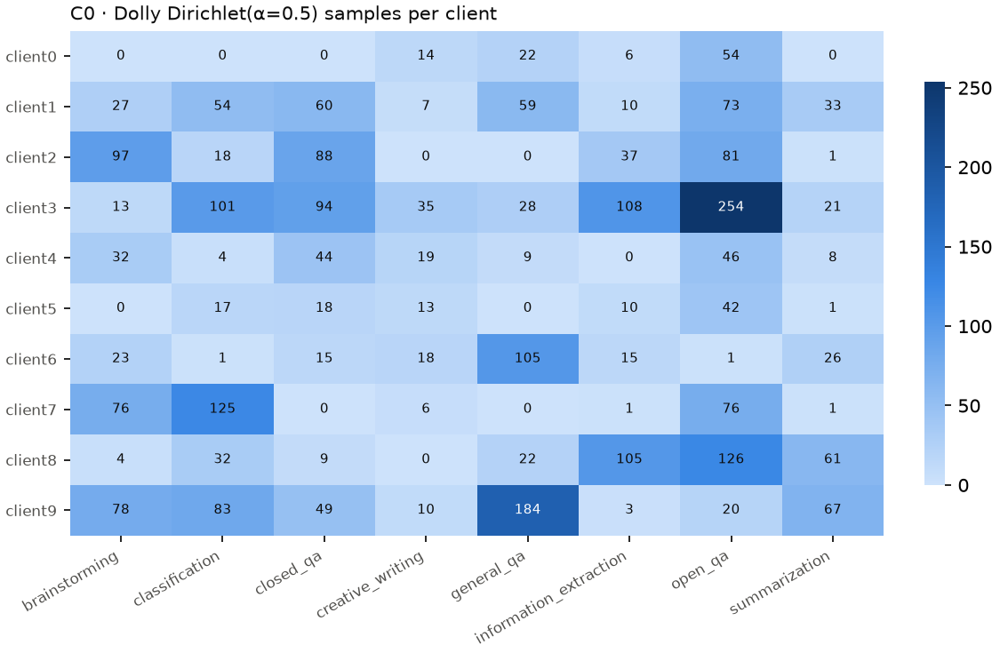
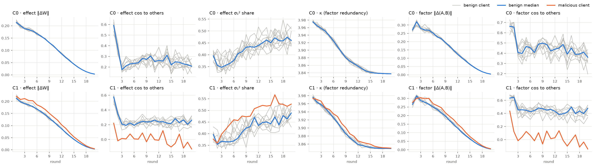
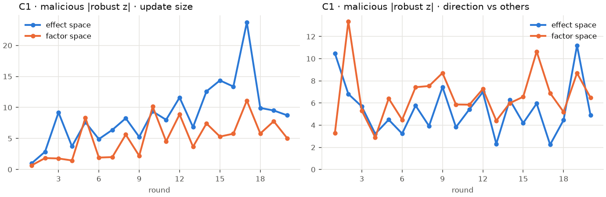

# P1 特征预实验结果

> 日期：2026-09-30
> 性质：**预实验**。Qwen2.5-0.5B-Instruct，单个随机种子，只有 1 个恶意客户端，攻击方式是"响亮"的有害问答训练。用于检查流程、筛选特征、预判方向，**不能作为论文结论**。主结论要在 7B 模型、多个种子、更隐蔽的攻击下重做（P2–P4）。
> 复现：`experiments/fedllm_attack/p1_runs.sh`（legion 上加 `EXTRA="--exp_precision bf16"`），分析用 `experiments/fedllm_attack/analyze_p1.py`。

---

## 1. 设置

| 项 | 设置 |
|---|---|
| 模型 | Qwen2.5-0.5B-Instruct，LoRA r=16、alpha=32，作用于 q_proj 和 v_proj |
| 联邦 | 10 个客户端全员参与，FedAvg，20 轮；每轮每个客户端本地训练 5 步（batch 4，序列 256），学习率 1e-4，按轮余弦衰减 |
| 良性数据 | databricks-dolly-15k 的 3000 条，按 8 个任务类别做 Dirichlet(α=0.5) 划分（图 1） |
| C0 | 10 个良性客户端 |
| C1 | 9 个良性客户端 + 1 个恶意客户端（编号 9），恶意客户端用 FedLLM-Attack 的 MaliciousGen 有害问答训练 |
| 检测 | 只挂 `effect_stats` 和 `factor_stats`，只输出特征，不做处置，不影响训练 |
| 设备 | 主结果在 legion（RTX 4050，bf16 混合精度）上跑；Mac（MPS，fp32）上的同配置结果作为对照 |

*图 1：C0 各客户端的类别分布。偏斜明显，客户端的数据量从 101 条到 654 条不等。*

---

## 2. 特征轨迹

*图 2：每个特征随轮次的变化。灰线是各良性客户端，蓝线是良性中位数，橙线是恶意客户端。第一行是 C0，第二行是 C1。*

观察：

1. **更新大小几乎随轮次线性下降**（效果层 ‖ΔW‖ 从 0.21 降到接近 0），这来自按轮的余弦学习率衰减。和大小有关的阈值必须按轮归一化，否则前期定的阈值到后期完全失效。这一点印证了复查文档 2.1 节的判断。
2. **第 1 轮是特殊的**：所有客户端从同一个初始化出发，而且 B=0，彼此的相似度很高，恶意客户端在两个空间里都分不出来。这与"前几轮不参与校准"的设计一致。
3. **恶意客户端的更新方向与良性客户端接近正交**（与其他客户端的余弦约为 0），在两个空间里都很明显。它的更新大小只是略大一些。
4. **效果层里，良性客户端之间本来就不太像**（余弦约 0.2–0.3），而因子层里约 0.4–0.5。因子层把相似度抬高了，原因是 A、B 各自都包含了共享全局部分的影响。
5. **κ 在所有客户端上几乎相同**（都在 3.84–3.98 之间，并且一起变化）。κ 是在累计因子上算的，累计因子被共享的全局部分主导，所以区分不出客户端。

---

## 3. 效果层与因子层的区分能力（Q1 的第一个数据点）

方法：每轮在所有客户端之间算每个特征的鲁棒 z 分数（中位数/MAD）。阈值取 C0 中每轮良性客户端最大 |z| 的 99% 分位；由于只有约 20 轮，这个分位基本就是最大值，所以阈值偏保守。统计 C1 中恶意客户端 |z| 超过阈值的轮数。

| 特征 | legion bf16 | Mac fp32（C0 只有 16 轮） |
|---|---|---|
| 效果层 ‖ΔW‖ | **15/20** | **17/20** |
| 因子层 ‖Δ(A,B)‖ | 11/20 | 11/20 |
| 效果层 与其他客户端的余弦 | 3/20 | 7/20 |
| 因子层 与其他客户端的余弦 | **17/20** | **16/20** |
| 效果层 σ₁² 占比 | 0/20 | 0/20 |
| κ | 5/20 | 0/20 |

*图 3：C1 中恶意客户端每轮的 |鲁棒 z|，蓝色为效果层，橙色为因子层；左图是更新大小，右图是与其他客户端的方向。*

结论（预实验）：

- **Q1 的答案不是"效果层全面更好"，要按特征类型分开看。** 更新大小在效果层更好；方向在因子层更好。两台设备、两种精度下结论一致。
- 效果层方向特征的问题不是信号弱：恶意客户端的余弦约为 0，良性约为 0.2。问题是良性客户端之间的余弦本身波动大，每轮的良性最大 |z| 最高到 7.85，把阈值抬高了。改进方向：
  - 在效果层用"与本轮其他客户端的均值方向"做参照时，按层或按模块分别计算余弦再聚合，减少少数层带来的噪声；
  - 或者把效果层的大小和因子层的方向组合成多视角分数，这正是判定引擎的设计。
- **σ₁² 占比单独用不了**：恶意客户端从第 6 轮起一直高于所有良性客户端，但良性客户端之间本身差异大，超不过保守阈值。它可能适合用"自身历史"作参照，而不是同轮横向比较。
- **κ 建议移除**，或者改为在本轮增量上计算。

---

## 4. 开销

| 设备 | 每轮本地训练（10 个客户端合计） | effect_stats | factor_stats | 检测占训练时间 |
|---|---|---|---|---|
| legion（bf16） | 21 秒 | 0.34 秒 | 0.05 秒 | 1.8% |
| Mac（fp32） | 82–102 秒 | 0.21 秒 | 0.03 秒 | 0.25–0.28% |

特征计算在 CPU 上做。GPU 训练越快，检测占比越高，但在这个规模下仍然可以忽略。7B 模型的估算见复查文档 3.1 节（10 个客户端的效果层 Gram 约 2 秒）。

另外在真实记录上验证了：2r 算法与展开大矩阵得到的 Gram 矩阵相对误差为 4e-14，速度快 23 倍（`check_effect_dense.py`）。

---

## 5. 局限

1. **攻击太"响"**：MaliciousGen 的有害问答和 Dolly 差异极大，恶意更新接近正交，任何方向特征都容易发现它。低比例混入、分散污染（C2）、知道防御的攻击者（C4）才是真正的考验。
2. **阈值样本太少**：约 20 轮只能得到约 20 个"每轮良性最大 |z|"，99% 分位基本就是最大值。P2 需要多个种子和更多轮次来估计良性分布。
3. **单个种子、单个模型、单一划分**。
4. **只看了统计特征**，没有行为层（H6）的确认。

---

## 6. 对后续阶段的影响

| 事项 | 调整 |
|---|---|
| P2 良性基线 | 在 legion 上用 bf16 跑 C0：IID 和 Dirichlet(0.1/0.5/1.0) × 3 个种子，并尝试 1.5B 模型；所有阈值按轮归一化 |
| 特征库 | 移除或改造 κ；为效果层方向特征增加"按模块计算余弦再聚合"的版本；σ₁² 占比改为以自身历史作参照 |
| P3 检测 | 判定引擎做"效果层大小 + 因子层方向"的多视角融合，加上处置策略模块（`tiered_policy`），把 `robust_outlier` 的分数转化为降权或剔除 |
| 攻击 | 加入低比例混入（恶意数据占客户端数据的 10–50%）作为 C1 的变体，检验在不那么"响"的攻击下特征是否仍然有效 |
