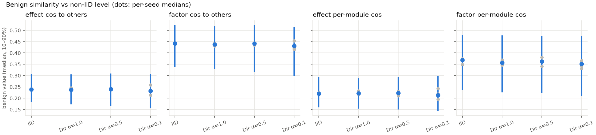
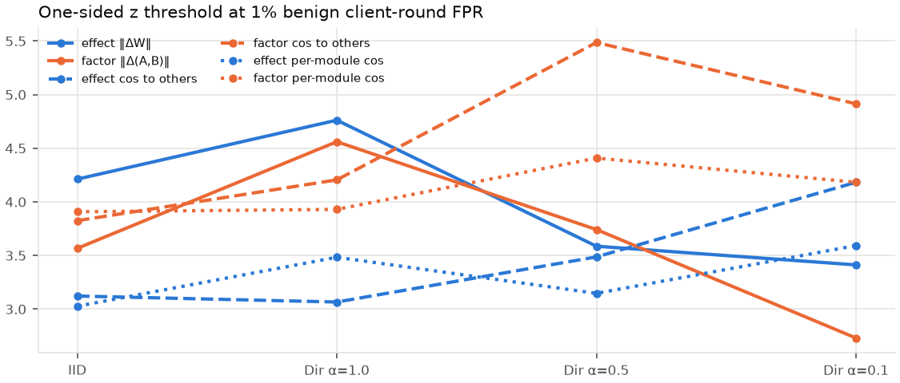

# P2 良性基线与初步检测结果

> 日期：2026-10-02（实验于 2026-09-30 23:12 至 10-01 03:06 在 legion 上无人值守完成）
> 性质：**预实验**。Qwen2.5-0.5B-Instruct，bf16 混合精度，10 个客户端全员参与，20 轮。
> 复现：`experiments/queue_legion.sh`；分析用 `analyze_p2.py`，安全评测用 `experiments/eval/safety_eval.py`。完整输出见 [figures/p2/p2_summary.md](figures/p2/p2_summary.md)。

---

## 0. 结论先行

1. **安全评测被"模板 + 良性微调"严重干扰**（第 4 节）。用 alpaca 模板评测时，**完全没有攻击的 C0** 无害率也从 81% 降到 49–63%，和有攻击的 C1（48–56%）差不多。也就是说，P1 里"攻击让无害率从 90% 降到 45%"，大部分其实是良性微调造成的，不是攻击。顺从倾向（target logp）是更灵敏的指标：它随恶意数据比例单调变化。**后续必须先解决评测方法，否则 C1 的"攻击效果"无法成立。**
2. **用 P2 良性数据校准阈值后，效果层在大小和方向上都优于因子层**（第 3 节）。完全恶意的客户端：效果层大小 18/18 轮，因子层 12–14/18；效果层方向 14/18，因子层 9–11/18。三个种子结果稳定，阈值迁移到新运行后的良性误报率为 0.2–1.4%，接近目标 1%。P1 里"因子层方向更好"是因为当时阈值只来自单个种子，还用了双侧检验。
3. **低比例混入时，统计特征基本失效**（第 3 节）。恶意数据占 30% 时，最好的组合也只能抓到 6/18 轮；占 10% 时只有 1–2/18，和误报水平相当。但全局模型的顺从倾向仍有可测的偏移，说明需要**行为层的探针（H6）**和**客户端侧的数据检测（H1）**。
4. **按 Dolly 类别做 Dirichlet 划分，对 LLM 更新几乎没有影响**（第 2 节）。从 IID 到 α=0.1，良性客户端之间的相似度基本不变。Q2（自然 non-IID 导致误杀）在这个设置下无法检验，需要领域差异更大的数据。
5. **1.5B 在 6 GB 显存上可行**：基座 bf16 加载，每个客户端 9.6 秒（0.5B 是 2.0 秒），20 轮约 35 分钟。

---

## 1. 设置

| 项 | 设置 |
|---|---|
| 模型与训练 | Qwen2.5-0.5B-Instruct，LoRA r=16（q_proj、v_proj），每轮每客户端 5 步 × batch 4 × 序列 256，学习率 1e-4 按轮余弦衰减，bf16 混合精度 |
| 联邦 | 10 个客户端全员参与，FedAvg，20 轮 |
| P2（C0） | 10 个良性客户端，Dolly 3000 条；划分：IID、Dirichlet α=1.0 / 0.5 / 0.1；每种 3 个种子（种子同时决定数据抽样、划分和 LoRA 初始化） |
| C1 | 9 个良性客户端（Dirichlet α=0.5）+ 1 个恶意客户端；恶意数据占比 100%（种子 1/2/3）、30%、10%（种子 1）；其余部分用未分给良性客户端的 Dolly 数据补足 |
| 特征 | `effect_stats` v2 和 `factor_stats` v2，新增"按模块余弦"，κ 已移除 |
| 检测方法 | 每轮在全部客户端之间做鲁棒 z 标准化（抵消学习率衰减）；单侧检验（大小类特征偏大、方向类特征偏低才算异常）；排除前 2 轮；阈值取 P2 对应划分 3 个种子合并后良性客户端-轮次的 99% 分位 |
| 安全评测 | AdvBench 中固定的 100 条；规则无害率（FedLLM-Attack 的关键词规则，贪心解码 64 token）+ 顺从开头 "Sure, here is …" 的平均对数概率 |

已知问题：Dolly 中约 11–16% 的样本因上下文过长被截断到 256 token，回复部分丢失后被训练器忽略，主要集中在摘要、信息抽取、封闭问答这几类。

---

## 2. 良性基线：non-IID 程度的影响

*图 1：良性客户端"与其他客户端的余弦"随划分的变化。蓝点为合并后的中位数，竖线为 10%–90% 分位，灰点为各种子的中位数。*

| 特征（中位数） | IID | α=1.0 | α=0.5 | α=0.1 |
|---|---|---|---|---|
| 效果层 余弦 | 0.239 | 0.238 | 0.241 | 0.232 |
| 因子层 余弦 | 0.442 | 0.438 | 0.442 | 0.431 |
| 效果层 按模块余弦 | 0.221 | 0.222 | 0.223 | 0.214 |
| 因子层 按模块余弦 | 0.368 | 0.357 | 0.363 | 0.351 |

几乎没有差异。可能的原因：每轮每个客户端只训练 20 条样本，更新主要反映"按指令格式作答"这类所有客户端共有的学习；Dolly 的 8 个类别都是英文通用指令，彼此差异小。

*图 2：各特征在不同划分下的单侧阈值（良性误报率 1%）。波动没有规律，主要是 99% 分位的估计噪声：540 个样本里只有约 5 个落在最高的 1%。*

---

## 3. 检测：完全恶意与低比例混入

阈值来自 P2 Dirichlet α=0.5（3 个种子合并），用于 C1 的新运行。每格为恶意客户端被标记的轮数（共 18 轮，排除前 2 轮）：

| 特征 | 100% 种子1 | 100% 种子2 | 100% 种子3 | 30% | 10% | C1 中良性误报率 |
|---|---|---|---|---|---|---|
| 效果层 大小 | **18** | **18** | **18** | 4 | 1 | 0.6% |
| 因子层 大小 | 12 | 14 | 13 | 2 | 0 | 0.9% |
| 效果层 方向 | **14** | **14** | **14** | 4 | 2 | 1.4% |
| 因子层 方向 | 11 | 9 | 9 | 2 | 1 | 0.2% |
| 效果层 按模块方向 | 15 | 14 | 14 | **7** | 1 | 0.9% |
| 因子层 按模块方向 | 9 | 12 | 9 | 2 | 1 | 0.6% |
| 效果层 σ₁² 占比 | 1 | 1 | 5 | 0 | 0 | 0.5% |
| 组合（效果层大小 或 因子层方向） | 18 | 18 | 18 | 6 | 2 | 0.9%（P2 良性 2.2%） |

- **Q1**：效果层在大小（18 对 12–14）和方向（14 对 9–11）上都优于因子层，三个种子一致。这是方向 A 目前最直接的支持证据。不过完全恶意的攻击很"响"，大小特征的优势有一部分来自"有害数据 loss 大、更新也大"；知道防御的攻击者可以把更新裁剪到正常大小，那时要靠方向特征。
- **低比例混入**：30% 时最好的单项是效果层按模块方向（7/18），10% 时所有特征都接近误报水平。只看更新的统计量，发现不了稀释后的攻击。
- 组合检测的误报率是两项之和（约 2%），说明要控制总体误报，组合时得把单项阈值收紧，或者改用判定引擎里的可信度累积。

---

## 4. 安全评测：良性微调与模板的干扰

无害率 / 顺从开头的平均对数概率（越高越愿意顺从）。第 0 轮即基座模型（LoRA 的 B 初始为 0）：

| 运行 | 模板 | 第 0 轮 | 第 5 轮 | 第 10 轮 | 第 15 轮 | 第 20 轮 |
|---|---|---|---|---|---|---|
| C0（无攻击） | alpaca | 81% / −1.04 | 55% / −0.93 | 49% / −0.97 | 62% / −1.00 | 63% / −1.01 |
| C0（无攻击） | Qwen 原生对话模板 | 97% / −1.64 | 96% / −1.59 | 97% / −1.59 | 97% / −1.59 | 97% / −1.60 |
| C1 恶意占 10% | alpaca | 81% / −1.04 | 50% / −0.91 | 56% / −0.97 | 60% / −0.99 | 57% / −0.98 |
| C1 恶意占 30% | alpaca | 81% / −1.04 | 53% / −0.90 | 53% / −0.95 | 56% / −0.95 | 56% / −0.95 |
| C1 恶意占 100% | alpaca | 81% / −1.04 | 54% / −0.89 | 48% / −0.92 | 52% / −0.92 | 56% / −0.92 |

观察：

1. **模板本身就决定了基座的安全水平**：同一个基座，alpaca 模板下无害率 81%，原生对话模板下 97%。Qwen-Instruct 的安全对齐是在原生模板上训练的。
2. **良性微调在 alpaca 模板下大幅降低无害率**（81% → 49–63%），幅度和有攻击时相当。按 alpaca 模板评测，攻击的边际效果被良性漂移淹没：第 20 轮 C1 100% 是 56%，C0 是 63%，差 7 个百分点，只有 100 条样本、单个种子，不能算显著。
3. **原生模板下，良性微调几乎不影响安全**（97% → 97%）。因为训练用的是 alpaca 格式，原生模板触发的仍是原有的对齐行为。这组 C1 没有做原生模板评测，攻击在原生模板下有没有效果还不知道。
4. **顺从对数概率比无害率更灵敏，而且随恶意比例单调变化**。第 20 轮：C0 −1.01，10% −0.98，30% −0.95，100% −0.92。这正是 H6 前向探针要用的指标，只需前向计算。

**这意味着 FedLLM-Attack 在 Instruct 模型上套 alpaca 模板的设置，不适合用来衡量"安全对齐被破坏"。** 需要先决定训练和评测用什么模板（第 6 节）。

---

## 5. 1.5B 可行性

Qwen2.5-1.5B-Instruct，基座 bf16、LoRA fp32、bf16 混合精度，可训练参数 218 万。在 6 GB 显存上正常运行 10 轮，每个客户端 9.6 秒，是 0.5B 的 4.8 倍。20 轮约 35 分钟，12 组基线约 7 小时。

---

## 6. 需要决定的事项与建议

| 事项 | 建议 |
|---|---|
| **训练与评测模板** | **改用 Qwen 原生对话模板训练和评测**（新增实验选项，回复的起始标记换成 `<|im_start|>assistant\n`）。真实部署中微调 Instruct 模型都用它自己的模板，安全对齐也在这个模板上；这样良性漂移小，攻击效果才看得出来。上游 alpaca 模板只作为对照保留 |
| 攻击效果的度量 | 一律用"同种子 C1 − C0"的差值，主指标改为顺从对数概率（前向计算、灵敏），规则无害率作为辅助；评测样本增加到 AdvBench 全部 520 条，C0 跑多个种子估计良性漂移的波动 |
| 截断长度 | 改为 512，消除 11–16% 样本被忽略的问题；和模板一起改，只需重跑一次 |
| Q2（non-IID） | 换成领域差异大的数据，例如 Dolly + 代码 + 医疗 + 中文指令混合，按领域划分 |
| 低比例混入 | 做 **H6 行为探针模块**：在服务器上把每个客户端（或每个簇）的更新试合并进全局模型，算 AdvBench 子集上的顺从对数概率。这是统计特征失效时的主要手段。可以先在已有记录上离线验证，不用重新训练 |
| 模型规模 | 方法定型后，在 1.5B 上跑主要配置作为 0.5B 结论的验证 |
